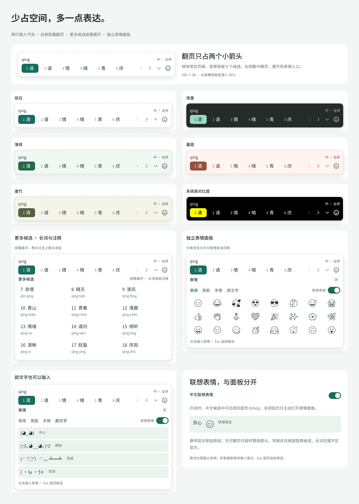
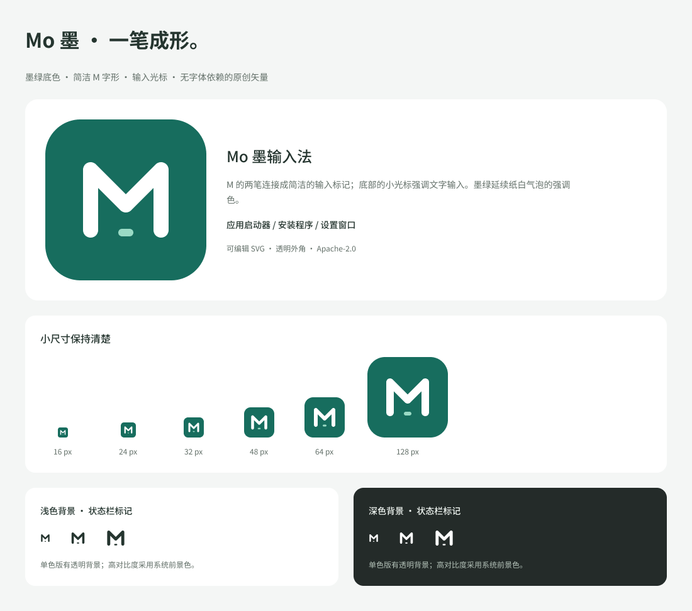

# 紧凑候选、表情与应用图标 · 2026-10-11

## 入口

- [新版候选与表情设计](https://www.figma.com/design/pFUWDZYKrLw9dxdNQ4XanU?node-id=66-549)
- [点击原型](https://www.figma.com/proto/pFUWDZYKrLw9dxdNQ4XanU?node-id=68-3444)
- [现代 Mo 图标](https://www.figma.com/design/pFUWDZYKrLw9dxdNQ4XanU?node-id=73-402)
- [应用 SVG](../../assets/icons/mo-app-icon.svg)、[Windows ICO](../../assets/icons/mo-app-icon.ico)

用户提供讯飞气泡截图作为横排与紧凑翻页参考；没有将截图、讯飞品牌或其图形
复制到 Mo 图层。用户确认“独立表情面板＋联想候选”，随后要求新增现代应用图标。

## 候选布局

默认两行：预编辑＋中/输入方案状态，横排候选＋右侧轻量操作。
560 × 86 设计像素，相比初版横排 520 × 120 的高度减少约 28%；
宽度有所增加，不能声称整体面积减少 28%。候选区示例为六项，不改变当前引擎页容量。

右侧四个 28 px 命中区：上一页、下一页、展开更多、表情。图标为 20 px，
上一页在第一页禁用；按钮用途由悬停说明呈现，不保留整行翻页页脚。
当前 Broker Snapshot 不携带页号/总页数或前后页可用状态；
真实禁用判定和数量展示须先扩展可信元数据，不能由前端猜测。

更多候选按需展开，示例展示额外十二项、长词和拼音注释。
这表示信息组织与交互方向，不代表目前五项引擎页已能一次返回十八项。
实现时按 owner DPI、候选字宽和 work area 自适应，窄屏优先减少首屏数量，
长词进入展开区域；继续保持页内索引与 revision 身份。

## 表情

独立面板提供常用、笑脸、手势和颜文字分类，支持关闭、返回当前候选；
中文联想开关与主动面板各自独立。现有 emoji 设置对应 Rime 联想偏好，
新面板需要另外接入提交路径，不能在窗口回调中绕过 Engine Actor 或 TSF 编辑锁。

原型已连接：翻到下一组合成候选和返回、展开/收起、打开/关闭表情、
Emoji 与颜文字分类切换、联想开关开/关，以及选择第一个 Emoji 的插入示例。
其余分类、搜索、最近使用、全部 Emoji 插入、快捷键、悬停提示和偏好持久化
属于实施要求，尚未绑定真实逻辑；原型不更改用户文件或输入。

Figma 的 Noto Color Emoji 初轮截图未显示字形，已换成可见的 Noto Emoji Regular
单色预览；Unicode 表情内容不变。产品可使用 Win10 的系统 Emoji 字体，
彩色显示、ZWJ/变体选择符和混合字体度量仍需实测；没有分发字体文件。

## 图标

墨绿圆角应用底、白色 M 与小输入光标。另有明暗背景的单色标记。
Figma 中为可编辑 SVG 图层与组件实例，原始 SVG 不依赖字体。
16/24/32/48/64/128 px 设计样例通过视觉检查；透明 PNG 和七档 ICO 已导出，
corner alpha 与 ICO 尺寸清单通过。应用图标 PNG 来自 SVG 的 WPF 几何渲染；
Figma 导出 PNG 的白底版本没有作为透明资产交付。

## 检查与记录

- 24 个候选组件变体：六种配色 × 紧凑/更多/Emoji/颜文字；
  另有十二个操作按钮、六个 Emoji 单元、五个原创操作图标和三个应用标记。
- 复用既有 Mo 变量、文字和阴影样式；增加 28 px 命中区变量和 Emoji 字体样式。
- 候选展示图：236 TEXT、191 FRAME、121 INSTANCE、42 VECTOR、3 ELLIPSE；
  图标展示图：17 TEXT、28 FRAME、13 INSTANCE、33 VECTOR；IMAGE fill 均为零。
- 最终截图 1280 × 1794 / 1100 × 972，文字、表情、颜文字、主图间距及小尺寸均通过。
  修正了图标缺少间距变量绑定，以及换变体后保留隐藏 grid 的旧 override。
- 原型使用 reactions.actions；created/mutated/removed IDs 与七个原型目标记录在
  figma/compact-*-state-20261011.json 和 figma/icon-state-20261011.json。
  初轮因返回大小超限的修改被工具回滚，已读画布确认后缩减报告重试，
  未留下重复构件。
- 06–11 JS 是交接脚本。依赖旧 ledger 的 STATE、helpers.js 和新 V2/PROTO/ICONS；
  不应在当前已完成文件中全量重跑创建流程。

## 实施边界

本轮完成 Figma 设计、原型和图标资产；原生源码仍为 7ea9ec6 的竖排呈现。
没有实现横排/展开/独立表情提交，也没有将新图标写入 PE/WiX。
下一轮先接入紧凑布局与真实分页元数据，再接入身份校验的表情提交和现有设置保存，
随后完成设置三页 UI。当前 MSI/VM、50/400 ms 时限和 G2/G3 状态不变。
