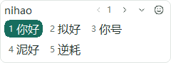
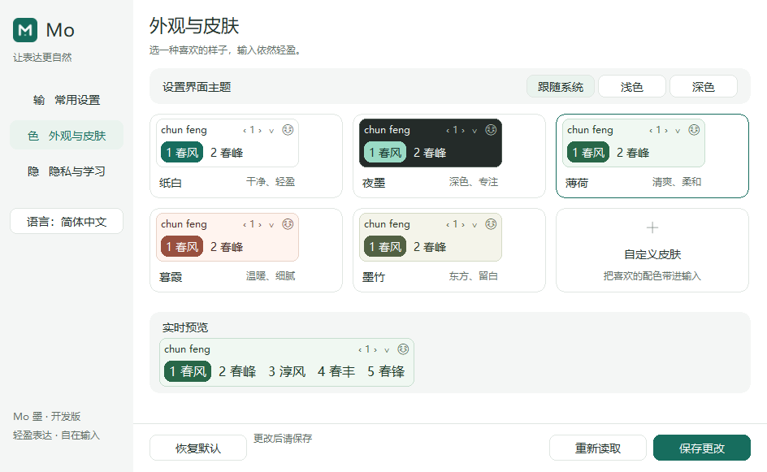

# Mo 紧凑 UI · 2026-10-12

用户反馈驱动的第二轮密度修订；设计与原生实现同时更新。

## 行为参考

[青简官方第一次输入说明](https://qingjian.app/docs/getting-started/first-input)将拼音、候选和页号分层，
默认竖排及每页数量可以修改。[搜狗官方皮肤说明](https://pinyin.sogou.com/help.php?list=2&q=6)
提供横排/竖排与同窗/分窗选择，默认横排同窗。Mo 采用完整默认候选、可选横竖排及紧凑页号的原则，
不照搬其页数、快捷键或引擎功能。本轮没有引入青简代码、字体、图标或皮肤资源。

## 默认候选

默认页即显示全部候选，详情按钮只用于查看注释网格。以当前页数据为边界，
不伪造额外候选或总页数；长词换行，窄屏自动多行，超高内容滚动。

## 设置密度

收紧外窗、侧栏、卡片及行间距，保留字体可读性。英语按钮和窄窗说明完整；
皮肤缩略图使用两词，实时预览保留五词并按内容收边。

## Figma

原文件的既有组件、变量和样式直接修订，含六种候选皮肤、四种状态及设置共享组件。
新增两块可编辑评审板：

- [紧凑候选 v3](https://www.figma.com/design/pFUWDZYKrLw9dxdNQ4XanU/Mo?node-id=207-1552)
- [紧凑设置 v3](https://www.figma.com/design/pFUWDZYKrLw9dxdNQ4XanU/Mo?node-id=216-388)

所有 UI 保持文本、Auto Layout、组件实例及变量绑定，没有整页截图填充。
Figma 使用可用的 Noto Sans SC，原生使用 Microsoft YaHei UI；字体度量、系统下拉控件和标题栏
不是像素一致。Figma 五词为 300×56，原生客机为 299×60，目标是完整内容及密度一致。
可选详情现显示当前页六词，Emoji 网格均分列宽；首轮溢出已经截图核验并修复。

[布局合同](../adr/0062-full-page-candidates-and-dense-settings.md) · [测试和包证据](../phase-0/WIN10-DENSE-UI-20261012.md)
