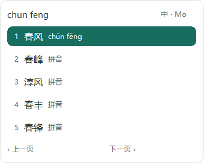
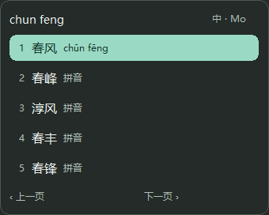

# Win10 原生候选气泡 · 2026-10-11

[Figma 设计](https://www.figma.com/design/pFUWDZYKrLw9dxdNQ4XanU?node-id=5-8)：
实际读取纸白 4:69 / 夜墨 4:120 的 get_design_context，均带截图，
没有静态位图或 SVG 资产。Figma 账号当前为 Professional / Full，读取正常。

现有浅色/深色主题已接入对应原生配色。系统配色、高对比度、
不抢焦点和带 revision 的候选行动继续保留。字号分层、圆角、边框、
注释和标签由 C++ 原生绘制。具体适配选择见 [ADR 0059](../adr/0059-candidate-modern-native-presentation.md)。

## 原生截图

两图来自本机 Win10 x64 实际 CandidateWindow 的 WM_PRINTCLIENT，
包含合成输入，仅截取 popup 客户区；不包含 Windows 外部阴影。
这不是注册/安装态桌面输入截图。

## 验证命令

~~~powershell
./native/windows-tip/build-probe.ps1 -Architecture All -Backend MSBuild
./tools/tip-broker-smoke.ps1 -Architecture All -RustToolchain 1.97.1
cargo +1.97.1 fmt --all -- --check
cargo +1.97.1 clippy --workspace --all-targets -- -D warnings
cargo +1.97.1 test --workspace
~~~

全部通过。最后 fake smoke 内包含 build/probe，实际日志
build/modern-candidate-final-smoke.log；Rust 各日志为 build/modern-candidate-rust-*.log。
源码、实际 PE、日志和 PNG 的 SHA 见
[evidence ledger](../phase-0/evidence/WIN10-CANDIDATE-MODERN-20261011.json)。

如需只输出合成渲染图，先创建新的本地输出目录，再运行
native/windows-tip/out/msbuild/x64/Release/mo_tip_candidate_preview.exe 加目录参数。
省略目录只执行断言；不包含桌面截图读取，不写真实候选或用户文档日志。
渲染和交互测试默认进入 build-probe；测试程序不进入产品 stage。

## 后续

继续按 Figma 实施设置的三页导航和分组布局，保留显式保存/恢复/重新读取、
冲突拒绝、当前编辑保留及隐私学习合同。其后定义皮肤持久化格式，再接入
薄荷/暮霞/墨竹、自定义、横排与实时预览；不能将设计稿入口声称为已实装。

新 UI 尚未打包或安装到 VM。真实 DPI/高对比度/宿主视觉、安装升级证据待后续收集，
G2/G3、原生 Rime 时限问题保持原状态。
