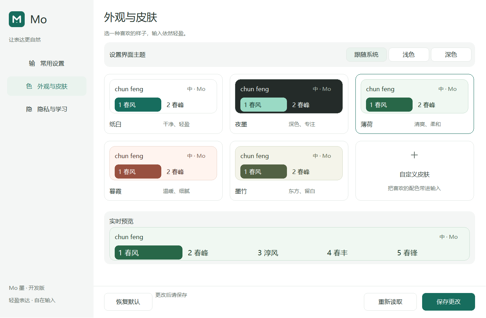
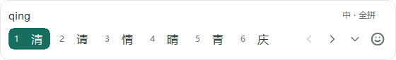
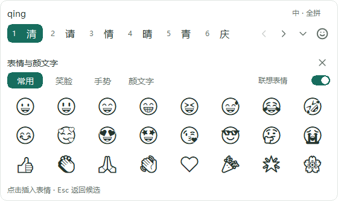

# Figma 设计的 Win10 原生改造 · 2026-10-12

## 已实施

Figma 文件 pFUWDZYKrLw9dxdNQ4XanU：设置 5:7、紧凑/表情 66:549、图标 73:402。
实现详情与兼容性见 [ADR 0060](../adr/0060-compact-candidates-symbols-and-skins.md)。

- 紧凑横排，工具栏内翻页；可信页信息控制禁用和高亮；按需展开当前页。
- 独立常用/笑脸/手势/颜文字面板，共 28 个固定项，支持完整 Unicode 提交与 Esc 返回。
  Rime 联想开关独立，可 checked save；提交始终经过 Actor 和 TSF 写锁。
- 常用、外观与皮肤、隐私与学习三页设置；五皮肤、自定义色板、字号、圆角、
  横排/竖排、数据皮肤导入导出；浅深色窗口主题和小窗口滚动。
- 现代图标嵌入 TIP 与设置可执行文件。原生字体/标题栏/系统阴影适配 Win10。
  Emoji 为系统字体的单色 GDI 呈现，未分发字体包。
- 原生控件保留键盘及可访问名称；布局/设置修改期间延后同步绘制回调，
  绘制回调使用共享状态引用。隐藏控件截图通过同一 owner-draw 函数绘制当前选项，
  不把截图看作真实窗口交互验收。

## 验证

环境 Win10 19045、Rust 1.97.1、VS2022/v143；开发分支 develop。

| 检查 | 结果 |
| --- | --- |
| cargo build --workspace / fmt --check / Clippy -D warnings | 通过 |
| cargo test --workspace | 173 项运行时＋1 项 compile-fail doc；1 ignored child 由父测试启动 |
| build-probe -Architecture All -Backend MSBuild | x64/Win32 /W4 /WX、ABI、策略、渲染 fixture 通过 |
| 合成原生 UI | 设置三页/自定义/深色/小窗口，候选五皮肤/自定义/竖排/表情截图复核通过 |
| 原生交互 fixture | focus、disabled caps、symbol ordinals、gap、stale press、工作区、200 次更新 GDI 通过 |
| fake tip-broker-smoke All | 两架构 IPC/pool/基本 TSF＋Emoji 通过；首轮 Win32 fault 首键失败，Win32 独立复跑通过 |
| 真实 Rime smoke All 首轮 | Actor/paging、x64 IPC/表情/pool 通过；x64 TSF 首键 N 62 ms 未消费，失败 |
| 真实 Rime All 独立复验 | x64 基本 TSF/表情/重入/终止通过；fault 第 0 轮前 N 62 ms 未消费，失败 |
| 真实 Rime Win32 独立检查 | Actor/paging、Win32 IPC/表情/pool 通过；TSF N 16 ms 未消费，失败，根因未定 |
| UI 资产/许可测试 | 八组 SVG/mask、28 项 Rust/native 索引、许可 hash、完整 MIT notice 通过 |
| 发布材料策略 | 历史 stage 的九归档/十七文档及八项正负向检查通过 |
| 发布合规策略 | 历史 132-file stage 的 12 项测试通过；没有新 UI stage/MSI 证据 |

真实测试使用已确认的 ABI3 DLL：
BE5E3E374D9FBE12381A0E3D522079033D85C08F4675F7A9A556A6DC3D30D564。
Shared 为历史 stage 的 pinned rime-ice；用户根为新建 build/mo-ui-rime-user-20261012-v1，
每次 smoke 再生成/清理 owned 子目录。没有使用用户日常输入数据或写入真实设置 profile。

原始本地命令输出位于 build/ui-20261011；绑定摘要、源码和截图见
[证据清单](../phase-0/evidence/WIN10-MODERN-UI-20261012.json)。
历史失败未被成功复跑覆盖。Win32 16 ms 失败不能解释为超过 50 ms。

## 预览

## 边界与下一步

本轮完成设计落地和本机受控验证。尚未创建新 MSI、升级 VM、验证安装态真实软件输入、
多个实际 DPI、高对比度 OS 切换或弹出文件/颜色对话框的视觉交互。
旧 0.0.13 开发包及最后 VM 0.0.11 身份不变。G2/G4 部分、G3 未通过；
50/400 ms 预算不变。

下一步先将新设置、Broker、两架构 TIP 配套生成开发包，再在 Win10 VM 验证升级、
真实宿主、皮肤保存/即时重绘和表情上屏。冷启动失败单独保留诊断入口，
不继续循环复验阻塞其他工作。搜索、最近表情、命名皮肤库及彩色 Emoji 属后续范围。
