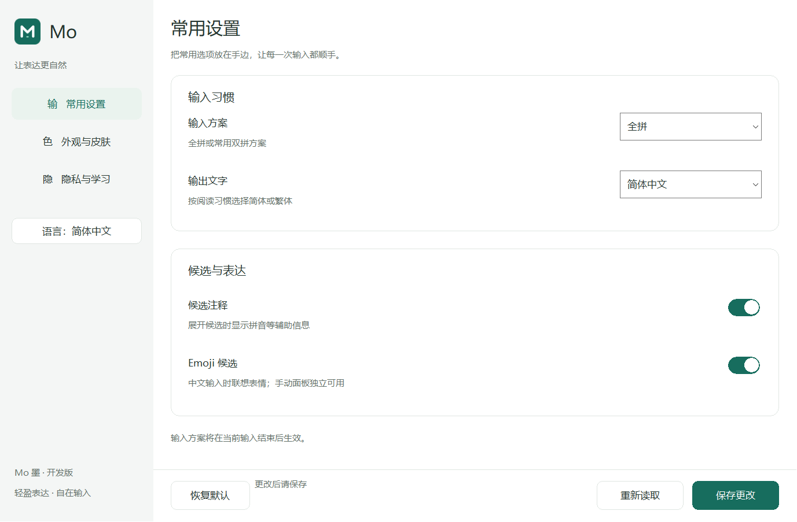
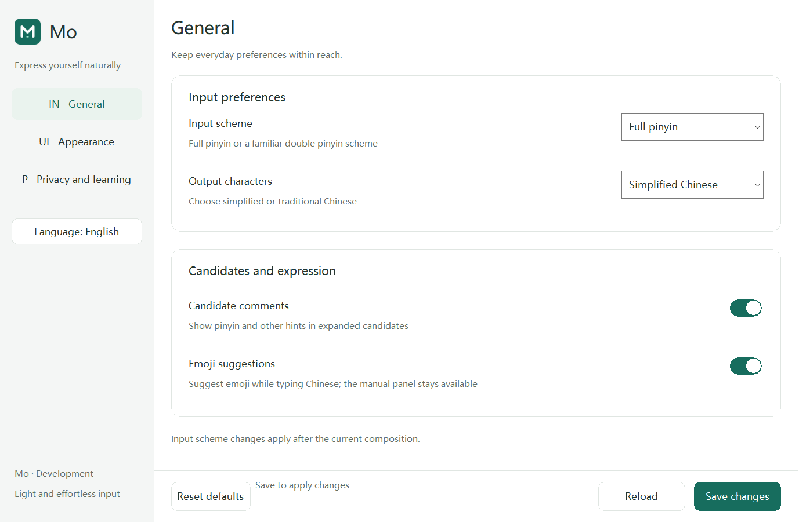
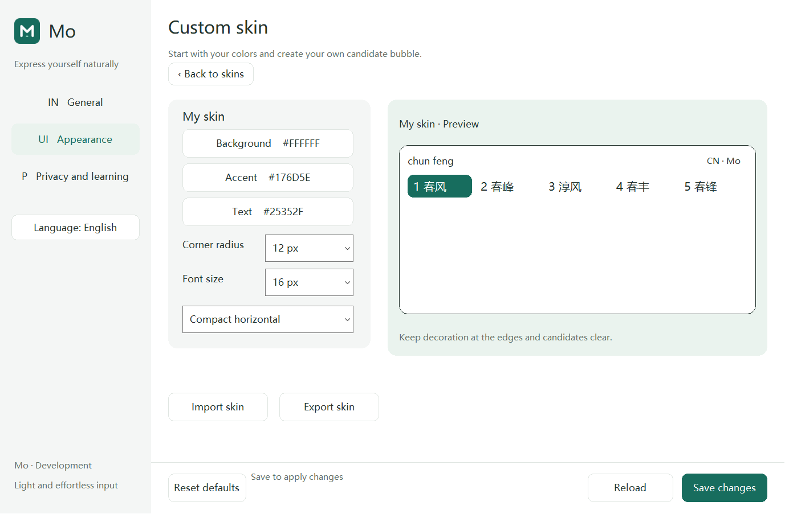
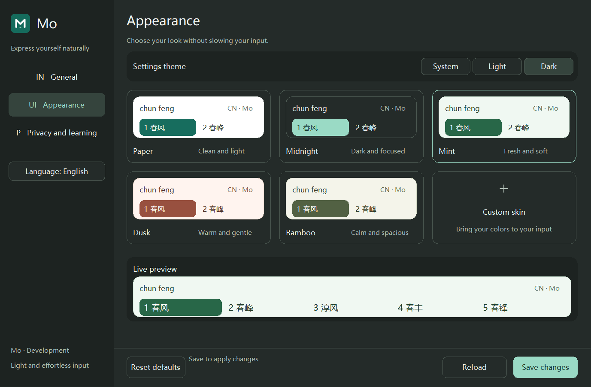
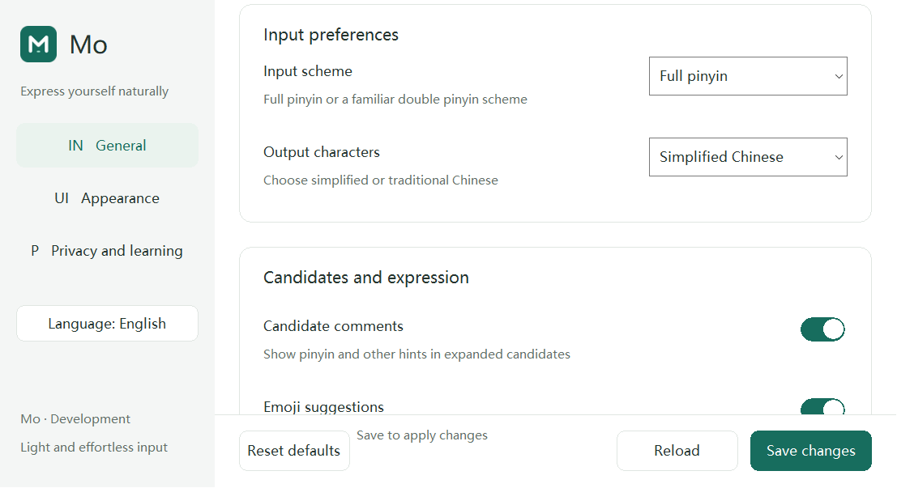

# 代码质量与设置文案审查：2026-10-12

## 审查依据与范围

用户要求消除业务魔法值、集中汉字文案、预留多语言及写入可审核的开发规范。
README 的“开发质量规范（项目执行标准）”为开发/审核入口，AGENTS 同步引用。
依据 Rust API Guidelines、Rust Book、Clippy 官方文档及 C++ Core Guidelines，
结合现有 Actor、FFI、IPC、安装和隐私 ADR；来源链接保留于 README。

本轮审查 Rust 设置模型、设置窗口、IPC 编解码、Broker watchdog/轮询、Pipe 端点，
以及工作区 lint 继承和资源封存策略。未对全部历史代码作无缺陷认证。

## 发现与修正

| 发现 | 修正及验证 |
| --- | --- |
| 设置/界面/协议的页面范围、圆角、字号和 RGB 边界散落 | 所属模块常量；UI 引用设置；跨组件遍历所有 u8 页/圆角/字号/皮肤输入及 RGB 边界 |
| skin 导入大小、IPC 固定偏移、highlight 哨兵与 CRC 多项字面量 | 命名边界、固定字段范围、u8::MAX、IEEE 多项式；独立 48 字节 golden 与 CRC 检查向量 |
| wire 编码数字在编码/解码重复 | repr(u8) 显式编码和 TryFrom；保留旧错误类别和字节 |
| Actor 超时、线程关闭和管道轮询缺少用途名称 | 独立预算/间隔常量；保留原值和前端 50/400 ms |
| 窗口页面用整数、调色板重复、常用尺寸/消息掩码缺少语义 | typed SettingsPage、具名调色板、DPI/窗口/滚动/位宽/BMP 常量 |
| 多个 crate 未继承统一 lint | workspace lint 继承；保留安全 crate/产品入口禁止 unsafe |
| 设置启动错误显示后仍可能成功退出 | ExitCode::FAILURE；合法启动返回 SUCCESS |
| 中文 UI 词条混在原生创建与绘制代码，翻译容易不一致 | 97 个 typed 键、完整中英文资源、同键控件/绘制/辅助功能复用 |
| 需改 Rust 才能定制措辞 | 有界数据覆盖文件；部分覆盖、模板字段检查、错误整份回退、不写引擎设置 |
| 英文长标签截断 | Appearance、Reset defaults、Font size 等简洁措辞；实际原生截图复验 |

## 本机验证

环境为 Win10 22H2 / Rust 1.97.1 / VS2022；输入和截图全部为合成数据。

- cargo fmt --all -- --check：通过。
- cargo clippy --workspace --all-targets -- -D warnings：通过。
- cargo clippy --workspace --all-targets --features mo-broker/latency-trace -- -D warnings：通过。
- cargo test --workspace：190 项运行时及 1 项 compile-fail doc 通过；既有 owned writer child
  入口按设计 ignored，由父测试单独启动。最终注释/测试转义整理后 settings-app 20 项复验通过。
- settings-app 新测试覆盖完整词条、局部覆盖、错误整份拒绝、字节上限、模板调序/
  参数不重解析、闭合语言标识、外部覆盖与启动偏好、启动参数失败路径。
- cargo build -p mo-settings-app 与两种 --language/--preview-dir：通过；每种生成 7 幅 BMP。
  实际按钮处理路径双向切换，原生语言控件 GetWindowText 校验通过；无真实 profile 写入。
- installer/windows/test-staging.ps1：71 项通过；UI 固定输入 21 个（含两份语言资源）。
- tools/tip-broker-smoke.ps1 -Architecture All -RustToolchain 1.97.1：最终协议重构后通过；
  x64/Win32 严格编译、16 路 pool、候选动作/布局/TSF/延迟取消和每架构两次 Broker
  退出/恢复、fail-open、EDIT/context 及不重放提交通过。

本轮没有重跑真实 librime，已有首键负向证据继续保留。G2/G3 不升级。
本地完整日志/原始 BMP 位于 build/quality-20261012，摘要绑定见
[证据清单](evidence/CODE-QUALITY-20261012.json)。截图仅核验本机受控呈现，不能代替安装态交互。

## 缓存维护

本轮完成后于 2026-10-12T04:39:08.2832327Z 核验默认 target 位于本仓库且无活动
编译/测试/运行程序/打包任务，再执行 cargo clean。清理 8,435 个文件，
逻辑文件大小 1,467,881,415 字节 → 0（约 1.37 GiB）；Cargo 报告 1.4 GiB。
保留 build 的封存包、stage、运行库、截图、日志和用户数据；未清理 Cargo 下载源。
清理之后没有为预热缓存重建。回执及清理输出绑定于证据清单。

## 截图

## 后续范围

- 历史细节绘制仍有裸坐标与字体索引，后续按组件收口为具名布局记录；不将相同数值
  但不同用途的参数强行合并。C++ 候选文案仍独立，当前资源覆盖范围仅为 Rust 设置窗口。
- 当前窗口语言切换不持久化，启动偏好仅通过文件/CLI；设置内持久语言选项可后续扩展。
- VM 保持已核验的 0.0.14.0；该包不包含本轮语言和常量源码变更。
  配套新包、Win10 安装态 UI、真实应用、多 DPI/高对比度及辅助工具验证尚待完成。
