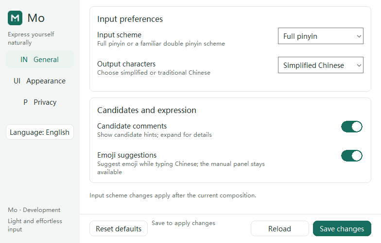

# Win10 紧凑 UI 与 0.0.16.0 开发包

日期：2026-10-12；develop。当前客机安装仍为 0.0.15.0，本轮独立预览与新包封存通过，
实际升级尚未执行。[结构化证据](evidence/WIN10-DENSE-UI-20261012.json)包含回执、哈希及失败历史。

## 变更与验收

| 项目 | 结果 |
| --- | --- |
| 默认 nihao 五词 | 原生客机 299×60，无需展开，文字完整 |
| 窄工作区 | 240×89 自动两行，全部候选槽通过独立测量 |
| 超长正文 | 中文/ASCII/补充 Unicode 换行；单条 512 字节可滚至尾部，视口 240×100 |
| 交互 | x64/Win32 默认选词、翻页、表情索引、禁用能力、间隙、过期点击、焦点/无激活、GDI 回归通过 |
| IPC/TSF 合成 | 双架构 fake IPC、16 槽池、Edit Session、取消/重入、两次 Broker 故障恢复通过 |
| Rust | fmt；默认及 latency-trace strict Clippy；193 运行时测试＋1 doc，1 ignored，通过 |
| UI 资产 | 图标掩码、目录序号、许可证及通知校验通过 |
| 客机设置 | static CRT release；中文/英文各 7 幅、语言切换和原生 caption，通过 |
| Figma | 两块可编辑评审板、六皮肤/四候选状态及共享设置组件完成视觉核验 |
| 0.0.16.0 包 | fresh source/release/双架构 ABI、stage、MSI/Burn 反解、ICE、Changed 升级对及 hash-locked kit 通过 |

## 可复核输入

默认工作区门禁日志在 build/dense-ui-20261012-v1，最终使用 *-complete.log。
客机候选回执在 MoEvidence/DenseCandidate-20261012-v6/guest-evidence，19 幅合成 BMP、exit 0。
设置回执在 MoEvidence/DenseUI-20261012-v5/guest-evidence，中文/英文各 7 幅、exit 0。
这两个独立程序从测试目录运行，没有修改已安装载荷、原设置、默认输入法或用户文档。

新 stage：build/mo-windows-stage-dense-0160-v1/stage；
安装包：build/mo-linked-win10-dense-0160-v1；
升级对：build/mo-win10-changed-pair-0150-0160-v1；
kit：build/mo-vm-changed-upgrade-kit-0150-0160-v1；
共享：build/win10-evidence-clean-v1/Package0160-v1/kit。
七份修改的代码/资源与封存 source_files 的 SHA256 已逐一核对。ADR/评审文档后补，不更改封存代码。
产物为 unsigned DevelopmentTest，含受控故障注入，不能作为正式发布包。

## 失败记录与修正

- 首轮 strict Clippy 拒绝测试中的常量 assert，已改编译期断言；两套门禁重新通过。
- 独立动态 CRT 程序在客机缺依赖，真实进程退出码为 0xC0000135；
  网络启动曾返回 guestcontrol 20，普通 PowerShell 进程对象还返回空 ExitCode。
  保留失败目录，核验身份后只结束自有卡住预览；按打包既有 +crt-static 规则和
  Diagnostics.Process 获取退出码，最终两语言通过。没有据此断言 VM 性能问题。
- 超长滚动的首轮样本 1200 字节超过已有 512 字节限额，被正确拒绝；改为合法上限，回归通过。
- 编译与 fmt 同时读写源文件时发生临时映射锁，编译完成后 fmt 及门禁通过。
- 首轮 Figma 默认第五项换行、表情固定列溢出、详情含旧额外候选，均通过可编辑约束修正并截图复核。
- 包装命令曾错误检查遗留 LASTEXITCODE、误认为 kit 有子目录；底层封存回执已通过，
  按其真实输出根目录复制，未覆盖封存材料。失败日志仍保留。

## 实际升级边界

17:28 的只读升级 preflight 仍观察到五个 TIP 宿主、三个已确认本用户的模块读取失败，
五个归属未解析；按仓库规则拒绝升级。没有调用安装器、强关用户进程或注销。
用户需要保存文档并注销/重新登录，以卸载记事本和 shell 旧 DLL；UAC 由用户确认。
未知归属没有被证明不存在，扫描不是全局无宿主证明。

G2/G3、真实 librime 首键 50/400 ms 和已记录的负向证据保持；
本轮不重复真实首键诊断。多物理 DPI、系统高对比度、辅助工具、真实宿主全交互仍待验收。

## 合成截图

## 缓存维护

本轮所有默认 target 使用者结束并核验路径后，于 2026-10-12 17:37（Asia/Shanghai）执行 cargo clean：
5,960 文件、1,191,069,223 逻辑字节（约 1.11 GiB）→ 0；磁盘实际空闲约增加 1.03 GiB。
逻辑字节与磁盘变化分别记录，不混淆压缩/分配差异。
保留封存包、stage、runtime、客机证据和 Cargo 下载源缓存，不为预热重建。
