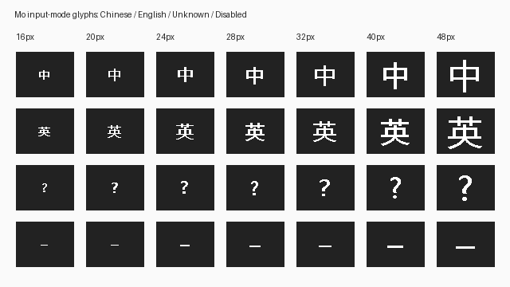

# 中英文任务栏状态项 · 0.0.20.0 开发包

2026-10-27 开始、10-28 封存，develop。[ADR 0066](../adr/0066-authoritative-taskbar-input-mode.md)、
[结构化证据](evidence/INPUT-MODE-0200-20261028.json)。

## 已实现

- 任务栏模式项显示“中 / 英”，Shift 抬起后依据真实 Rime 状态刷新。
- 空闲点击切换；组词、待应用按键、过期 revision 和错误 session 拒绝变更。
- 新会话、设置替换和重连重新读取模式；无连接或旧协议显示未知，不猜测中文。
- 新注册系统托盘类别，支持安装/卸载/回滚；v2 凭据保留 v1 兼容读取。
- 单色图标供系统着色，中英文资源化 tooltip；处理通知失败重试和重入停用。

原生状态缺失时不再默认为中文；新增两项测试覆盖状态缺失及模式/禁用独立性。

原生图标工厂输出的样张如下，属于 GDI 合成证据，**不是真实任务栏截图**。

## 验证

- 固定 Rust 1.97.1：fmt、默认和 latency-trace strict Clippy 通过；workspace 207 通过、1 ignored。
- x64/Win32 /W4 /WX；COM item 注册/移除、通知/cookie/重入 Deactivate、卸载引用计数，
  七种尺寸单色 mask 和双语言 tooltip 通过。x64 trace 构建亦通过。
- 双架构 Fake IPC、16 槽池、TSF 编辑锁/完整 EDIT、候选/标点/光标/终止重入、
  每架构两次 Broker 崩溃恢复通过；模式查询/点击/陈旧及组词保护/重连通过。
- 真实 Rime Actor 查询和显式切换通过；188 个字符状态、Shift 符号、快捷键、
  快慢斜杠审查通过。真实 Rime IPC 模式变更/会话替换/池通过。
- 真实 TSF + Rime 夹具已确认点击与 Shift 两轮“中→英→中”同步。
  **完整 real TSF smoke 仍失败**：接着第一个 N 在原 50 ms 预算内未得到响应。
  两次默认失败日志及一次 trace 诊断保留；trace request=11/kind=5，
  phase=Header，error=1460，total=50179 us，header=50161 us，write=6 us。
  这只定位等待响应头超时，尚不能归因于 VM、引擎计算或宿主调度；没有放宽时限。
- 注册器双架构事务自测包括 v2 八种状态与 v1 四种状态、两类操作；
  主机隔离注册表和普通用户前置检查通过。升级 policy 34 / transaction 22 通过。

失败保留：mode-native-build.log（SDK GUID/CONNECT 声明）、mode-native-build-v3.log
（LANGID 缩窄）、mode-icon-preview-build.log（错误链接库名），均已修复；
mode-rime-smoke.log / mode-rime-final.log / mode-trace-abi.log 的首键失败未宣告解决。
原始日志位于仓库 build；结构化记录保存验证范围及文件哈希。

## 配套包与部署

- stage：build/mo-windows-stage-mode-0200-v2/stage。
- MSI/Burn：build/mo-linked-win10-mode-0200-v2；unsigned DevelopmentTest，仅供受控 VM。
- pair：build/mo-win10-changed-pair-0180-0200-v2。
- kit：build/mo-vm-changed-upgrade-kit-0180-0200-v2。
- 新包包含 0190 按键修复；Broker、TIP 和注册器需一起升级。
- 138 个 stage 文件、132 个源码库存与当前仓库匹配；MSI/Burn/ICE、Changed pair，
  v1 的 stage policy 98 项通过（策略未改）；最终 v2 独立完成库存/源码/ABI/MSI/Burn/ICE 核验。没有执行安装器。
- 客机 C:/MoDev/Packages/0.0.20.0-v2 的 14 个包内文件与 kit 清单哈希核验通过，
  回执确认实际仍0180、Session1；共享回执位于 Package0200-v2/guest-kit-receipt.json。

机器实际安装经本轮只读回执核验仍为 **0.0.18.0**；本轮没有请求 UAC 或执行安装器。
0190 两次不可见 UAC 取消及 VBox 截图 E_FAIL 根因仍未解决，不重复发起同样请求。
新包封存/传输核验不表示安装态验收。真实任务栏、主题/高对比度、
Explorer 生命周期和物理切换，以及首键 50/400 ms，仍是待验项目。

## 缓存维护

封存及传输完成后，确认本项目无编译/测试/Broker/打包任务，cargo metadata 的 target_directory
为仓库默认 target，逐项核查路径和 reparse point 后执行 cargo clean。
同时回收本次 stage 的 working/rust-target、working/native-obj，及已对封存 tar 哈希的
working/rime-ice-source；清理本轮三个合成测试用户目录。首轮回收约1.45GiB，最终v2再回收约0.92GiB；另退役v1的载荷、安装器及提取副本约0.59GiB。
本轮主机合计回收约 **2.95 GiB 逻辑文件占用**。
stage 复核通过，源码快照、原生探针、日志、运行库、0180 基线、0190 旧包和0200待升级包保留。
详见[首轮清理](evidence/INPUT-MODE-CLEANUP-20261028.json)、
[最终清理](evidence/INPUT-MODE-CLEANUP-V2-20261028.json)及
[v1退役清单](evidence/INPUT-MODE-V1-RETIREMENT-20261028.json)。
v1源归档只在与v2保留归档SHA-256相同后去重，清单、源码及日志保留，旧根目录标记RETIRED。
客机v1的三个旧二进制也已校验原哈希后删除；后续只使用v2。不为预热重新构建。
