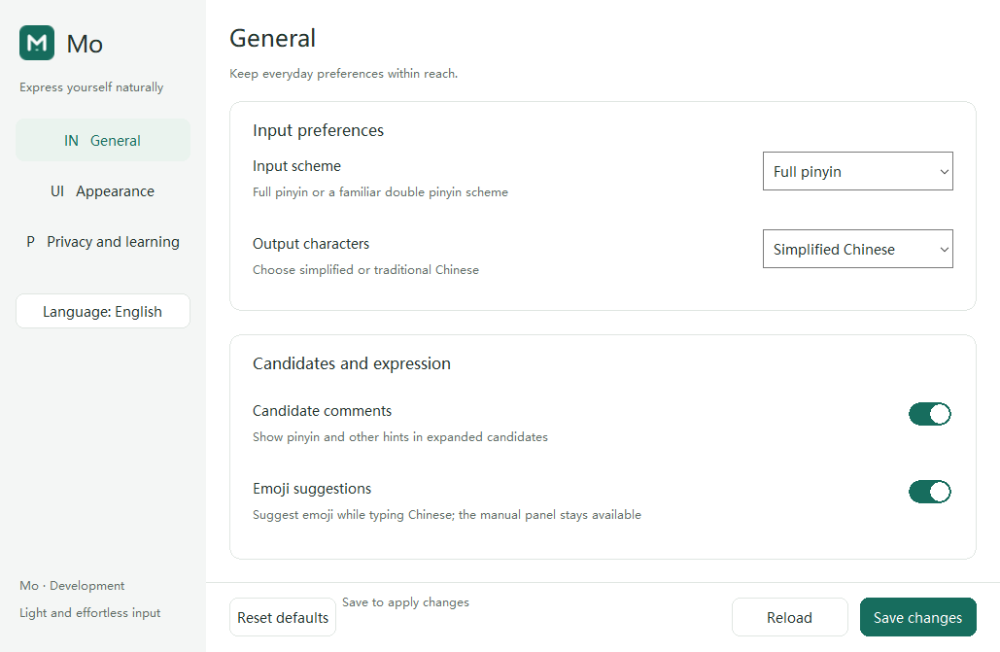
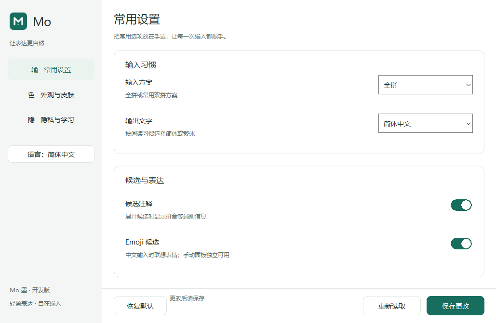
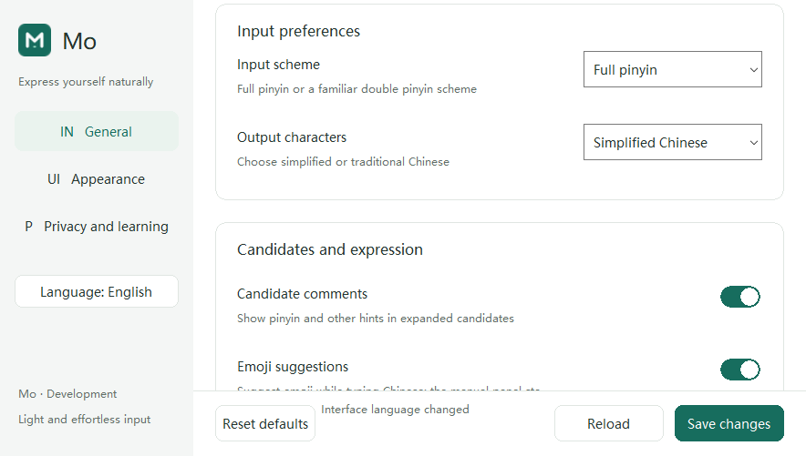

# 设置布局与 Win10 0.0.15.0 开发包 · 2026-10-12

## 本轮完成

- 设置绘制的 33 处字体选择改为 FontRole，区分正文、说明、标题、分区及候选。
  字体大小、字重和绘制表现保持；不再依赖调用点的裸数组索引。
- SidebarLayout/ FooterLayout 将导航、语言入口、品牌和底部按钮/状态区收口到
  具名逻辑像素记录。控件及绘制复用几何，底部间隔由相邻区域关系导出。
- 新增独立旧坐标 golden 和受支持宽度的不重叠检查。首轮 golden 捕获状态区
  356 px 与旧 352 px 不一致；将左间隔由 10 改为正确的 6 px。
  首轮失败日志及 v1 stage/package 保留，升级只使用修正后的 v2，未修改封存产物。

## 验证

| 检查 | 结果 |
| --- | --- |
| fmt / 默认及 latency-trace strict Clippy | 通过 |
| 工作区测试 | 192 运行时＋1 compile-fail doc 通过；既有 owned-child 入口按设计 ignored |
| 实际 release 二进制本机预览 | 中文/英文各 7 幅，14 幅与重构前逐像素一致 |
| 新 stage | fresh offline release / x64＋Win32 严格编译及 ABI 通过；132 payload / 138 总条目 |
| 封存源码 | 123 文件，包含两份语言资源及本轮 Windows UI；源码哈希与 cf13a1a 一致 |
| 运行库/词库 | 127 项与 0.0.14.0 文件身份一致；本轮不改变资源和热路径 |
| MSI/Burn | 链接、反解载荷绑定和 MSI ICE 通过；仍为 unsigned DevelopmentTest |
| 升级 pair/kit | 0.0.14.0 → 0.0.15.0 Changed-payload 合同与 kit 哈希通过 |

新包位置：build/mo-linked-win10-localized-0150-v2；stage：
build/mo-windows-stage-localized-0150-v2/stage；kit：
build/mo-vm-changed-upgrade-kit-0140-0150-v2。共享及客机复制已核验：
MoEvidence/Package0150-v2/kit、C:/MoDev/Packages/0.0.15.0。
kit 只能针对当前 0.0.14.0 基线；证据目录不得复用。

## Win10 客机设置呈现

通过 guestcontrol 在普通用户下运行同一 staged release 设置 EXE 的 --preview-dir。
包位于 C:/MoDev/Packages/0.0.15.0-preview-v2，证据为
C:/MoDev/Evidence/Preview0150-v2，回传到 MoEvidence/PreviewGuest0150-v2。
所有 profile、输入数据及覆盖标签均为自有合成数据；未安装、未启动引擎，
原安装 EXE 与真实 settings-v1.mo 在前后保持不变。

四组均 exit 0、各 7 幅 BMP、语言按钮切换/原生 caption 更新通过：

1. 显式 zh-CN。
2. 显式 en-US。
3. 独立启动偏好选择英文，并加载部分文案覆盖；截图可见 Synthetic custom hints。
4. 中文命令行覆盖英文启动偏好。

[客机回执字段副本](evidence/WIN10-SETTINGS-PREVIEW-0150-20261012.json)、
[源码/包/日志/截图清单](evidence/WIN10-LOCALIZED-0150-20261012.json)。

## 缓存维护

所有本机编译、打包和预览结束后，核验默认 target 位于本仓库且无活动任务，
于 2026-10-12 13:44（Asia/Shanghai）执行 cargo clean：4,117 文件、
804,224,070 逻辑字节 → 0（767 MiB）。保留封存 stage/包、运行库和测试证据，
没有清理 Cargo 下载源缓存或为预热缓存重建；原始 UTC 回执绑定于清单。

## 0.0.14.0 → 0.0.15.0 实际升级

用户确认已保存/关闭设置并切回原输入法后，读取 profile.active=false，核验闲置
Broker 的 Program Files 路径和 0.0.14.0 载荷哈希，停止并等待退出。随后从普通权限
64-bit PowerShell 发起既有 kit 的唯一升级，未代操作安全提示或修改安全策略。

升级材料为 C:/MoDev/Packages/0.0.15.0，客机证据为
C:/MoDev/Evidence/Upgrade0150-v2，返回到 MoEvidence/ChangedUpgradeGuest0150-v2。

| 升级检查 | 结果 |
| --- | --- |
| 0.0.14.0 基线/载荷/ACL/机器 COM | 通过 |
| 新安装器 | exit 0 |
| 新 0.0.15.0 载荷/ACL/机器双视图 COM | 通过 |
| 原 settings-v1.mo 和默认输入法 | 保持不变 |
| 最终 Installed 状态 | final_state_verified=true；failure/final_state_failure=null |
| 两份安装日志 | 回传 size/SHA256 与客机回执匹配 |
| 包/kit/基线/升级身份 | 回执与封存 kit 一致，独立复核通过 |

[升级回执字段副本](evidence/WIN10-UPGRADE-0150-20261012.json)。
HKCU com.x64/com.x86 为 missing 符合机器级 COM 合同；机器双视图另有审计通过。

启动 guestcontrol 命令曾返回 20，但客机 launch-state 和唯一 driver 仍在运行；
随后该 driver 完整成功。启动通道非零输出保留，不重复安装、不据此推断 VM 性能。
原始 launch 输出及 stdout/stderr 绑定到证据清单。

## 已安装设置程序呈现

从 C:/Program Files/Mo/bin/mo-settings.exe 启动合成 --preview-dir，核验安装 EXE
SHA256 等于新 stage。中文启动、英文切换、原生 caption 更新及 7 幅截图通过。
真实设置在检查前后不变；与先前同一客机 staged 预览 7/7 逐像素一致。
这项验证来自实际安装文件，但 profile 和候选仍为合成数据。

[安装态合成回执](evidence/WIN10-INSTALLED-PREVIEW-0150-20261012.json)。

## 边界与下一步

当前 VM 已安装 0.0.15.0，原设置窗口及测试 Broker 已关闭。本轮没有执行真实桌面
输入、loaded-TIP 升级或重启；合成截图不能代替普通用户窗口的完整交互验收。
下一步集中 Win10 普通应用的候选翻页、表情上屏/Esc、设置保存与即时重绘。

没有新增真实 librime 首键复跑；历史负向结果与 50/400 ms、G2/G3 保持。
物理 DPI、OS 高对比度、辅助工具、完整键盘/鼠标/宿主及 loaded-TIP 矩阵尚未验收。
历史细节卡片/候选绘制仍有裸坐标，后续按组件继续收口；本次没有宣称全产品无魔法值。
